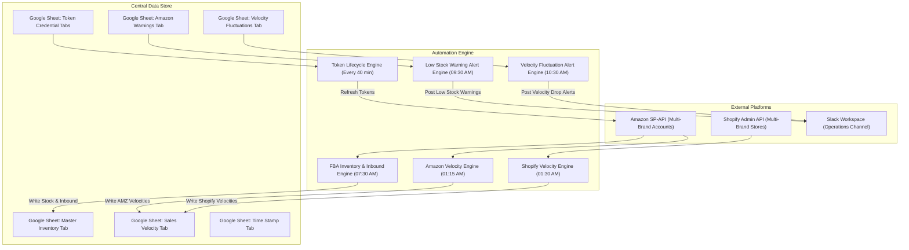
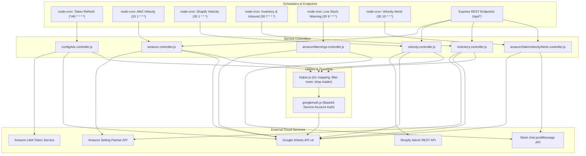

# Consolidated Inventory Project
## Comprehensive Business & Technical Architecture Documentation

---

# Part I: Non-Technical Business Guide

## 1. Executive Overview

The **Consolidated Inventory Project** is an enterprise-grade eCommerce operations and supply chain automation engine engineered to synchronize, consolidate, and monitor multi-brand retail performance across **Amazon FBA (Fulfillment by Amazon)** and **Shopify Direct-to-Consumer (D2C)** channels into a single unified Google Spreadsheet ecosystem.

Modern multi-brand retail organizations face severe operational hurdles when managing inventory across multiple marketplaces and stores:
* **Fragmented Channel Data:** Sales and inventory numbers are scattered across disparate Amazon Seller Central accounts and individual Shopify storefronts.
* **Complex Inbound Pipeline Tracking:** Inbound inventory sent to Amazon warehouses exists across various logistics states (shipped, receiving, active, voided, closed), making it difficult to calculate true inbound quantities.
* **Multipack & Bundle Misalignment:** Items sold as bundles or kits on Shopify consume distinct physical warehouse units (Base SKUs), creating discrepancies between sales velocity and stock depletion.
* **Delayed Stockout Alerts:** Supply chain planners often discover low stock or collapsing sales velocity days after the event occurs, resulting in stockouts and lost revenue.

The **Consolidated Inventory Project** resolves these operational challenges through a scheduled, autonomous backend system that:
* **Consolidates Multi-Brand Amazon Inventory:** Automatically queries the Amazon Selling Partner API (SP-API) across all active brands to aggregate real-time FBA stock levels (fulfillable, reserved, unsellable, researching) and inbound shipment pipelines.
* **Harmonizes Multi-Window Sales Velocities:** Computes standardized rolling sales velocity metrics (Yesterday, 2 Days Ago, 7-Day daily average, 14-Day daily average, 30-Day daily average) across both Amazon FBA and Shopify D2C listings.
* **Executes Dynamic Bundle Decomposition:** Decomposes Shopify bundle listings into foundational Base SKUs and attributes sales velocity back to individual physical units.
* **Monitors Low Stock & Dispatches Slack Alerts:** Automatically scans inventory health and sales velocity fluctuations every morning, dispatching formatted alerts directly to supply chain Slack channels.
* **Manages Cloud Token Lifecycles:** Dynamically refreshes Amazon Login with Amazon (LWA) tokens and Shopify OAuth credentials directly against the spreadsheet without service interruption.

---

## 2. Business Architecture & Operational Flow

The system acts as an autonomous data orchestration bridge connecting external commerce platforms, Google Sheets, and team communications:



### Strategic Business Benefits
* **Complete Channel Visibility:** Unifies inventory and velocity data across multiple independent brand accounts in one consolidated view.
* **Accurate Inbound Tracking:** Automatically tracks units not yet located (`unitsNotLocated = quantityShipped - quantityReceived`), filtering out cancelled or stale shipments over 50 days old.
* **Proactive Risk Mitigation:** Morning Slack alerts notify logistics teams of inventory shortages or sudden demand drops before they impact fulfillment.
* **Self-Contained Architecture:** Uses the central Google Spreadsheet as the database, eliminating the overhead of dedicated database hosting.

---

## 3. Google Sheets Ecosystem & Tab Anatomy

The operational data store consists of dedicated tabs inside the central Google Spreadsheet:

### 1. Amazon Access Token Tab (Configurable via `SHEET_GET_AMAZON_ACCESS_TOKEN`)
The authentication registry holding per-brand credentials for Amazon Selling Partner API.
* **Headers:** `Brand Name`, `Access Token`, `Refresh Token`, `clientId`, `clientSecret`.
* **Operational Cycle:** Scanned every 40 minutes by `cronUpdateToken()`. Refreshed access tokens are written back to the `Access Token` column for seamless multi-brand operations.

### 2. Shopify Access Token Tab (Configurable via `SHEET_GET_SHOPIFY_ACCESS_TOKEN`)
The authentication registry holding per-brand credentials for Shopify stores.
* **Headers:** `Brand`, `Shop Name`, `Api Key`, `Client ID`, `Client Secret`.
* **Operational Cycle:** Supports both legacy static API keys and modern 2026 OAuth Client ID/Secret credentials. Evaluated dynamically during each Shopify velocity sync.

### 3. Master Inventory Tab (Configurable via `INVENTORY_SHEET`)
The central supply chain ledger tracking physical stock across Amazon fulfillment centers.
* **Header Hierarchy:**
  * **Row 1 (Primary Category Headers):** Contains high-level category groupings (e.g., `Amazon`).
  * **Row 2 (Attribute Subheaders):** Contains discrete metrics: `Sku`, `Fulfillable`, `Reserved`, `Unsellable`, `Inbound`, `Researching`.
  * **Row 3+ (Product Records):** Product records where stock figures are updated via batch writes.
* **Automated Injection:** The backend populates warehouse quantities and inbound quantities directly against matching SKUs.

### 4. Sales Velocity Tab (Configurable via `SALES_VELOCITY_SHEET`)
Consolidates multi-window sales velocity figures across Amazon and Shopify channels.
* **Header Hierarchy:**
  * **Row 1 (Primary Category Headers):** Contains channel groups: `Amazon` and `D2C - Shopify`.
  * **Row 2 (Attribute Subheaders):**
    * Amazon Block: `Brand Name`, `Sku`, `ASIN`, `SV Yesterday`, `SV 2 days ago`, `SV 7 days`, `SV 14 days`, `SV 30 days`.
    * Shopify Block: `Brand Name`, `Base Sku`, `Sku`, `Country`, `SV Yesterday`, `SV 2 days ago`, `SV 7 days`, `SV 14 days`, `SV 30 days`.
  * **Row 3+ (Product Records):** Data rows updated during nightly synchronization runs.

### 5. Shopify SKU Translation Tab (Configurable via `SHOPIFY_SKU_SHEET`)
Defines the mapping between Shopify catalog listings and physical warehouse Base SKUs.
* **Headers:** `Shopify SKU`, `Base SKU`, `Country Code`, `Quantity of Base SKU`.
* **Operational Function:** Expands Shopify variant listings into Base SKUs so bundle and multipack demand is accurately attributed to individual items.

### 6. Amazon Warnings Tab (`Amazon_Warnings`)
A specialized analytical tab calculating inventory coverage and stockout risks.
* **Layout:** Rows 1-4 contain sheet metadata and summary calculations. Product risk rows begin at Row 5.
* **Monitored Columns:** `SKU` (Col B), `ASIN` (Col C), `Max Velocity` (Col G), `AMZ On Hand Days` (Col K), `In Transit Days` (Col L), `Total Amazon Days` (Col M).
* **Operational Cycle:** Scanned daily at 09:30 AM CET to generate Slack low-stock notifications.

### 7. Sales Velocity Fluctuations Tab (Configurable via `AMAZON_SALES_VELOCITY_FLUCTUATIONS_SHEET`)
Monitors day-over-day and week-over-week velocity changes to detect demand anomalies.
* **Layout:** Row 3 contains group headers (`Yesterday vs 2 days ago`, `SV 7 days vs SV 14 days`). Row 4 contains subheaders (`Sku`, `ASIN`, `Change %`, `Flag -1`, `Flag -2`). Data starts at Row 5.
* **Operational Cycle:** Scanned daily at 10:30 AM CET to post Slack velocity alerts.

### 8. Audit Trail Sheet (`Time Stamp`)
Records execution history for operational monitoring.
* **Headers (Row 2):**
  * `Shopify Start Time`, `Shopify Time Stamp`, `Shopify End Time`
  * `Amz. Velocity Start Time`, `Amz. Velocity Time Stamp`, `Amz. Velocity End Time`
  * `Amz. Inventory Start Time`, `Amz. Inventory Time Stamp`, `Amz. Inventory End Time`

---

## 4. Core Business Workflows & Calculation Logic

### 1. Multi-Window Rolling Sales Velocity
Sales velocity is calculated across five discrete time windows to provide immediate, short-term, and monthly demand indicators:
* **Yesterday Velocity (`SV Yesterday`):** Total units sold during the previous calendar day divided by 1. Formula: $\text{Units} / 1.0$.
* **2 Days Ago Velocity (`SV 2 days ago`):** Total units sold exactly two days prior divided by 1. Formula: $\text{Units} / 1.0$.
* **7-Day Rolling Velocity (`SV 7 days`):** Total units sold over the past 7 days divided by 7. Formula: $\text{Units} / 7.0$.
* **14-Day Rolling Velocity (`SV 14 days`):** Total units sold over the past 14 days divided by 14. Formula: $\text{Units} / 14.0$.
* **30-Day Rolling Velocity (`SV 30 days`):** Total units sold over the past 30 days divided by 30. Formula: $\text{Units} / 30.0$.

### 2. Inbound Pipeline Calculation & Age Filtering
Tracking items shipped to Amazon fulfillment centers requires reconciling inbound plans and shipments:
* **Units Not Located Formula:**
  $$\text{Units Not Located} = \text{Quantity Shipped} - \text{Quantity Received}$$
* **Status Exclusion:** Shipments marked `CANCELLED`, `CLOSED`, or `DELETED` are excluded ($\text{Units Not Located} = 0$).
* **Age Cutoff:** Shipments created more than 50 days ago relative to the current date are excluded to prevent stranded inventory numbers from inflating available stock.

### 3. Shopify Bundle Expansion Logic
When a Shopify order includes bundle or multipack items, the system looks up the mapping in the `Shopify SKU Translation` sheet:
* If a Shopify SKU maps to one or more Base SKUs, the velocity record is duplicated for each Base SKU.
* If no mapping exists, the original SKU is retained with a blank Base SKU field.
* This ensures that physical warehouse consumption is visible alongside marketing listing identifiers.

### 4. Slack Notification Triggers & Thresholds
The system executes automated Slack alerting based on structured business rules:
* **Low Stock Warning (09:30 AM CET):** Scans `Amazon_Warnings` for all active SKUs. Builds native Slack Block Kit bullet lists detailing ASIN, Max Velocity, On Hand Days, In Transit Days, and Total Days with a direct sheet link.
* **Velocity Fluctuation Alerts (10:30 AM CET):** Scans `Amazon_Sales_Velocity_Fluctuations`. When `Flag -1` (daily drop) or `Flag -2` (weekly drop) contains an issue message (not "No Issues"):
  * A drop greater than 20% ($\text{Change \%} < -20\%$) receives a Red Circle indicator.
  * A moderate drop ($\text{Change \%} < 0\%$) receives a Yellow Circle indicator.
  * Formatted alerts with SKU, ASIN, Change %, and Flag message are posted to the operations Slack channel.

---

## 5. Daily Operational Lifecycle & Background Schedule

```mermaid
sequenceDiagram
    autonumber
    participant Engine as Consolidated Backend Service
    participant AMZ as Amazon SP-API
    participant Shop as Shopify Admin API
    participant Sheets as Google Sheets
    participant Slack as Operations Slack

    Note over Engine: Recurring Token Sync (Every 40 Minutes)
    Engine->>Sheets: Read Token Sheet
    Engine->>AMZ: Exchange Refresh Tokens (LWA)
    Engine->>Sheets: Update Access Tokens

    Note over Engine: Nightly Velocity Processing
    01:15 AM CET->>Engine: Amazon Velocity Cron
    Engine->>AMZ: Query Order Metrics (1d, 2d, 7d, 14d, 30d)
    Engine->>Sheets: Batch update Amazon velocity columns

    01:30 AM CET->>Engine: Shopify Velocity Cron
    Engine->>Shop: Query Orders across all shops
    Engine->>Sheets: Read Base SKU map & expand velocities
    Engine->>Sheets: Batch update Shopify velocity columns

    Note over Engine: Morning Inventory & Inbound Processing
    07:30 AM CET->>Engine: Inventory Cron
    Engine->>AMZ: Query FBA Inventory Summaries
    Engine->>AMZ: Query Inbound Plans & Shipments
    Engine->>Sheets: Update Fulfillable, Reserved, Unsellable, Inbound

    Note over Engine: Morning Slack Alerts
    09:30 AM CET->>Engine: Warnings Cron
    Engine->>Sheets: Read Amazon_Warnings tab
    Engine->>Slack: Post Low Stock Warning Block Kit message

    10:30 AM CET->>Engine: Velocity Alert Cron
    Engine->>Sheets: Read Amazon_Sales_Velocity_Fluctuations tab
    Engine->>Slack: Post Velocity Fluctuation Warning Block Kit message
```

---

## 6. Operational FAQ & Business Troubleshooting

* **Q: Why are Amazon velocity figures showing zero for a brand?**
  * *Check 1:* Verify the brand's row in the Amazon Access Token sheet. Ensure `clientId`, `clientSecret`, and `Refresh Token` are valid.
  * *Check 2:* Check if the Amazon token refresh ran successfully or if credentials expired on Amazon Developer Central.
* **Q: How does the system handle new Shopify brands without permanent tokens?**
  * The system automatically checks for `Client ID` and `Client Secret` in the Shopify token sheet. If present, it executes the modern 2026 OAuth client credentials flow to acquire a fresh 24-hour token automatically.
* **Q: Why was an inbound shipment quantity excluded from the sheet?**
  * Shipments older than 50 days or marked `CANCELLED`, `CLOSED`, or `DELETED` are automatically zeroed out to prevent stale logistics data from misrepresenting current stock.
* **Q: What happens if an operator reorders columns in the Google Sheet?**
  * The system dynamically resolves column indices by matching exact header names (e.g., `Brand Name`, `Sku`, `Fulfillable`, `SV Yesterday`), ensuring that reordering columns does not corrupt data mapping.

---

# Part II: Technical Architecture & System Reference

## 1. System Architecture

The Consolidated Inventory Project is built on Node.js using Express 5:



---

## 2. Source Code Directory Structure

```
consolidated-inventory/
├── config/
│   └── googleAuth.js                       # Google Service Account auth loader (Base64 env var)
├── controller/
│   ├── amazon.controller.js                # Amazon SP-API sales velocity engine (orderMetrics)
│   ├── amazonSalesVelocityAlerts.controller.js # Sales velocity fluctuation analyzer & Slack alerts
│   ├── amazonWarnings.controller.js        # Low-stock warning analyzer & Slack Block Kit notifier
│   ├── configAds.controller.js             # Amazon LWA token refresh & multi-brand token provider
│   ├── inventory.controller.js             # FBA inventory summaries & 2-tier inbound shipment engine
│   └── velocity.controller.js              # Shopify multi-brand order ingestion & SKU expansion
├── jobs/
│   ├── amazonSalesVelocityAlertsJob.js     # Scheduled cron job wrapper for velocity drop alerts
│   └── amazonWarningsJob.js                # Scheduled cron job wrapper for low-stock warnings
├── routes/
│   ├── amazon.routes.js                    # Mounts /api/fetchAmazon and schedules 01:15 cron
│   ├── amazonSalesVelocityAlerts.routes.js # Mounts /api/salesVelocityAlerts/trigger
│   ├── configAds.routes.js                 # Schedules */40 token refresh cron
│   ├── inventory.routes.js                 # Mounts /api/fetchInventory and schedules 07:30 cron
│   └── velocity.routes.js                  # Mounts /api/fetchVelocity and schedules 01:30 cron
├── helper.js                               # Shared Google Sheet utilities & shop credentials loader
├── index.js                                # Application entry point, Express setup, cron initialization
├── package.json                            # Project dependencies and operational scripts
└── .env                                    # Environment configuration variables
```

### Detailed Component Responsibilities
* `index.js`: Initializes Express application, enables JSON and CORS middlewares, mounts API routes under `/api/*`, registers background warning crons, declares health check route `GET /`, and listens on `PORT`.
* `config/googleAuth.js`: Decodes `GOOGLE_SERVICE_ACCOUNT_BASE64` environment variable into Google credentials and initializes `google.auth.GoogleAuth` with `https://www.googleapis.com/auth/spreadsheets` scope.
* `helper.js`:
  * `colIndexToA1(colIdxZeroBased)`: Algorithmic conversion from zero-indexed integer to spreadsheet column letters.
  * `showAllRowsKeepFilter(sheetId, headerRowIndexZeroBased, colCount)`: Dispatches `setBasicFilter` requests without criteria to reset user filters and ensure deterministic batch updates.
  * `ensureTimestampSheetExists()`: Validates and initializes the `Time Stamp` sheet.
  * `getAllShopApiKeys()`: Parses `SHEET_GET_SHOPIFY_ACCESS_TOKEN` to extract multi-brand Shopify store credentials.
* `controller/configAds.controller.js`:
  * `cronUpdateToken()`: Iterates through each brand in `SHEET_GET_AMAZON_ACCESS_TOKEN`, posts refresh requests to `AUTH_LINK`, and updates `Access Token` cells.
  * `getAccessToken()`: Reads token tab and returns an in-memory dictionary mapping brand names to active access tokens.
* `controller/amazon.controller.js`:
  * `fetchAndUpdateSalesVelocity()`: Executes multi-window order metric requests per brand and SKU, managing 50-call token refresh intervals and writing to `SALES_VELOCITY_SHEET`.
  * `fetchSalesData()`: Rate-limited HTTP client querying `/sales/v1/orderMetrics` with exponential backoff on 429 and 5xx responses.
* `controller/inventory.controller.js`:
  * `fetchAndUpdateInventory()`: Paginates `/fba/inventory/v1/summaries` to collect fulfillable, reserved, unsellable, and researching quantities.
  * `fetchAndUpdateInboundShipment()`: Paginates `/inbound/fba/2024-03-20/inboundPlans` to retrieve active inbound plans.
  * `fetchShipmentDetails()`: Retrieves shipment details from `/inbound/fba/2024-03-20/inboundPlans/{id}/shipments/{id}`.
  * `fetchShipmentProductDetails()`: Retrieves product details from `/inbound/fba/2024-03-20/inboundPlans/{id}/shipments/{id}/items`.
  * `fetchInboundQuantity()`: Calls legacy endpoint `/fba/inbound/v0/shipments/{id}/items` to reconcile shipped vs received quantities and computes unlocated units with a 50-day cutoff.
* `controller/velocity.controller.js`:
  * `fetchShopifyVelocityData()`: Clears old velocity cells, paginates orders across all configured Shopify stores, calculates 5 rolling velocity windows by SKU and country, expands Base SKUs via mapping, and batch-updates the sheet.
* `controller/amazonWarnings.controller.js`:
  * `fetchAmazonWarningsAndNotify()`: Reads `Amazon_Warnings` from row 5, builds Slack Block Kit message with rich text bullet lists, and posts to Slack channel.
* `controller/amazonSalesVelocityAlerts.controller.js`:
  * `fetchSalesVelocityAlertsAndNotify()`: Analyzes `Amazon_Sales_Velocity_Fluctuations` from row 5, checks percentage drop thresholds, maps colored alert indicators, and posts to Slack.

---

## 3. Data Pipelines & Transformation Logic

### Phase 1: Dynamic Amazon LWA Token Lifecycle
1. `configAds.controller.js` reads `SHEET_GET_AMAZON_ACCESS_TOKEN!1:1` to resolve column positions for `Brand Name`, `Access Token`, `Refresh Token`, `clientId`, `clientSecret`.
2. Reads all credential rows (row 2+).
3. Dispatches HTTP POST to `AUTH_LINK` (`https://api.amazon.com/auth/o2/token`) using `grant_type=refresh_token`.
4. Writes fresh `access_token` and `refresh_token` back to the sheet using `spreadsheets.values.update`.
5. Employs a 500ms inter-request delay to prevent rate-limiting.

### Phase 2: Amazon Sales Velocity Engine
1. Loads dynamic brand tokens via `getAccessToken()`.
2. Resolves two-tier headers from `SALES_VELOCITY_SHEET` (Row 1 group `Amazon` mapped to Row 2 subheaders).
3. Clears basic sheet filters using `showAllRowsKeepFilter()`.
4. Defines date boundaries:
   * `last1Days`: `getDateRange(1)` (yesterday).
   * `lastTwoDays`: `getSingleDayRange(2)` (2 days ago).
   * `lastSevenDays`: `getDateRange(7)`.
   * `lastFourteenDays`: `getDateRange(14)`.
   * `lastThirtyDays`: `getDateRange(30)`.
5. Iterates through existing sheet SKUs. For each SKU, executes `fetchSalesData()` against `/sales/v1/orderMetrics` with a 2000ms inter-call spacing.
6. Every 50 calls per brand, triggers an internal token refresh to ensure tokens remain valid during long execution cycles.
7. Dispatches batch updates (`spreadsheets.values.batchUpdate`) with `USER_ENTERED` formatting.

### Phase 3: Shopify Sales Velocity & Base SKU Expansion
1. Reads all brand credentials from `SHEET_GET_SHOPIFY_ACCESS_TOKEN` via `getAllShopApiKeys()`.
2. Clears previous velocity values in `SALES_VELOCITY_SHEET!{col}3:{col}` via `batchClear`.
3. For each shop, resolves access tokens (static key or OAuth exchange) and fetches 30 days of orders (`created_at_min = now - 31d`, `created_at_max = now - 1d`, offset `-05:00`).
4. Groups line items by `${brand}|${date}|${sku}|${country}`.
5. Indexes rows by `${sku}|${country}` and computes rolling averages:
   * $\text{v1} = \text{units} / 1.0$
   * $\text{v2} = \text{units} / 1.0$
   * $\text{v7} = \text{units} / 7.0$
   * $\text{v14} = \text{units} / 14.0$
   * $\text{v30} = \text{units} / 30.0$
6. Reads `SHOPIFY_SKU_SHEET` to build `skuBaseMap`. Replicates velocity rows for each associated `Base SKU`.
7. Upserts data into `SALES_VELOCITY_SHEET` by matching `${sku}|${baseSku}|${country}`.

### Phase 4: FBA Inventory & Two-Tier Inbound Shipment Processing
1. Queries `/fba/inventory/v1/summaries` across all active brand tokens using recursive pagination (`nextToken`).
2. Extracts fulfillable, reserved, unsellable, and researching counts per SKU.
3. Upserts stock numbers into `INVENTORY_SHEET` starting from Row 3.
4. Queries Inbound Plans `/inbound/fba/2024-03-20/inboundPlans` across statuses `SHIPPED`, `VOIDED`, `ACTIVE`.
5. Retrieves shipment headers and item listings via `/inbound/fba/2024-03-20/inboundPlans/{id}/shipments/{id}/items`.
6. Queries legacy shipment item details via `/fba/inbound/v0/shipments/{id}/items` to reconcile `QuantityShipped` and `QuantityReceived`.
7. Filters shipments: excludes `CANCELLED`, `CLOSED`, `DELETED` and shipments older than 50 days.
8. Sums `unitsNotLocated` by SKU and batch-updates the `Inbound` column in `INVENTORY_SHEET`.

### Phase 5: Slack Warning & Fluctuation Alert Dispatching
1. **Low Stock Warnings (09:30 AM):** Reads `Amazon_Warnings!A5:M`. Formats structured Slack Block Kit message with bullet hierarchies and posts to `SLACK_CHANNEL_INVENTORY_WARNINGS`.
2. **Velocity Fluctuation Alerts (10:30 AM):** Reads `Amazon_Sales_Velocity_Fluctuations!A5:M`. Checks `Flag -1` and `Flag -2`. If flags contain issues, parses `Change %` and attaches colored alert indicators before posting to Slack.

---

## 4. Third-Party APIs & External Integrations Reference

### Integration 1: Amazon Selling Partner API (SP-API) & LWA
* **Purpose:** Multi-brand catalog inventory, sales velocity extraction, and inbound logistics tracking.
* **Base URL:** `https://sellingpartnerapi-na.amazon.com` (configurable via `ROOT_LINK_SELLER`)
* **LWA Token URL:** `https://api.amazon.com/auth/o2/token` (configurable via `AUTH_LINK`)
* **Authentication:** Access token header (`x-amz-access-token: {ACCESS_TOKEN}`). Tokens are generated via OAuth2 refresh token exchange.
* **Endpoints Utilized:**
  * `POST /auth/o2/token`: LWA refresh token exchange (`grant_type=refresh_token`, `client_id`, `client_secret`, `refresh_token`).
  * `GET /sales/v1/orderMetrics`: Pulls aggregated unit counts for specific SKUs over defined intervals (`granularity=Total`, `marketplaceIds`).
  * `GET /fba/inventory/v1/summaries`: Pulls warehouse inventory levels (`granularityType=Marketplace`, `details=true`, `nextToken`).
  * `GET /inbound/fba/2024-03-20/inboundPlans`: Pulls inbound shipping plans (`status=SHIPPED,VOIDED,ACTIVE`, `pageSize=10`).
  * `GET /inbound/fba/2024-03-20/inboundPlans/{inboundPlanId}`: Retrieves specific inbound plan metadata.
  * `GET /inbound/fba/2024-03-20/inboundPlans/{inboundPlanId}/shipments/{shipmentId}`: Retrieves shipment metadata.
  * `GET /inbound/fba/2024-03-20/inboundPlans/{inboundPlanId}/shipments/{shipmentId}/items`: Retrieves shipment product manifests.
  * `GET /fba/inbound/v0/shipments/{shipmentId}/items`: Reconciles shipped vs received item quantities.
* **Rate-Limit Resilience:** Implements exponential backoff on HTTP 429 and 5xx errors, throttles calls with mandatory minimum delays (2000ms for order metrics, 500ms for inventory), and refreshes tokens every 50 calls per brand.

### Integration 2: Shopify Admin REST API (Version 2023-10)
* **Purpose:** Multi-brand order extraction and sales velocity calculation.
* **Base URL:** `https://{shopName}.myshopify.com/admin`
* **Authentication:**
  * Legacy Stores: Static API token header (`X-Shopify-Access-Token: {API_KEY}`).
  * Modern Stores (2026 OAuth): Dynamic client credentials exchange via `POST /oauth/access_token` (`grant_type=client_credentials`, `client_id`, `client_secret`).
* **Endpoints Utilized:**
  * `POST /admin/oauth/access_token`: Acquires temporary 24-hour access token for modern Shopify apps.
  * `GET /admin/api/2023-10/orders.json`: Extracts orders across rolling 30-day window (`status=any`, `limit=250`, `fields=created_at,line_items,billing_address`).
* **Pagination:** Evaluates standard RFC 5988 HTTP `Link` header (`rel="next"`) to traverse consecutive order pages.

### Integration 3: Slack Web API
* **Purpose:** Automated operations alerts for low stock levels and velocity drops.
* **Base URL:** `https://slack.com/api`
* **Authentication:** Bearer token header (`Authorization: Bearer {SLACK_BOT_TOKEN}`).
* **Target Endpoint:** `POST /chat.postMessage`
* **Payload Structure:** Slack Block Kit format utilizing `rich_text`, `rich_text_list` (bullet hierarchies), and emoji indicators.

### Integration 4: Google Sheets API v4
* **Purpose:** Primary application database and operational reporting layer.
* **Client Library:** `googleapis` (`v170.0.0`) initialized with Base64 service account credentials.
* **Scope:** `https://www.googleapis.com/auth/spreadsheets`
* **Operations Utilized:**
  * `spreadsheets.get`: Metadata inspection, sheet validation, and internal sheetId retrieval.
  * `spreadsheets.values.get`: Reading header configurations, credentials, inventory rows, and warning triggers.
  * `spreadsheets.values.update`: Updating specific cell ranges (tokens and execution timestamps).
  * `spreadsheets.values.batchUpdate`: High-performance batch updates of inventory and velocity data.
  * `spreadsheets.values.batchClear`: Purging old velocity columns prior to rewriting.
  * `spreadsheets.batchUpdate`: Structural spreadsheet modifications (`addSheet`, `setBasicFilter`).

---

## 5. Internal API Endpoints & cURL Reference

### 1. Root Health Check
* **Route:** `GET /`
* **Description:** Verifies service availability and operational status.
* **Response (200 OK):**
```json
{
  "success": true,
  "message": "🚀 Server is running successfully!"
}
```
* **cURL Command:**
```bash
curl -X GET http://localhost:3000/
```

### 2. Manual Shopify Velocity Sync
* **Route:** `GET /api/fetchVelocity`
* **Description:** Manually triggers full multi-brand Shopify velocity extraction and Base SKU expansion. Responds immediately with processing status while pipeline runs in the background.
* **Response (200 OK):**
```json
{
  "status": "processing",
  "message": "Shopify sales velocity data is being processed. Please check the Time Stamp sheet."
}
```
* **cURL Command:**
```bash
curl -X GET http://localhost:3000/api/fetchVelocity
```

### 3. Manual Amazon Sales Velocity Sync
* **Route:** `GET /api/fetchAmazon`
* **Description:** Manually triggers Amazon SP-API multi-brand sales velocity sync.
* **Response (200 OK):**
```json
{
  "status": "processing",
  "message": "Amazon sales velocity data is being processed. This may take time — please check the Time Stamp sheet for completion status."
}
```
* **cURL Command:**
```bash
curl -X GET http://localhost:3000/api/fetchAmazon
```

### 4. Manual Amazon Inventory & Inbound Sync
* **Route:** `GET /api/fetchInventory`
* **Description:** Manually triggers Amazon FBA inventory summaries and 2-tier inbound shipment synchronization.
* **Response (200 OK):**
```json
{
  "status": "processing",
  "message": "Inventory data is being processed. This may take time — please check the Time Stamp sheet for completion status."
}
```
* **cURL Command:**
```bash
curl -X GET http://localhost:3000/api/fetchInventory
```

### 5. Manual Sales Velocity Fluctuation Alert Trigger
* **Route:** `POST /api/salesVelocityAlerts/trigger`
* **Description:** Manually scans `Amazon_Sales_Velocity_Fluctuations` and dispatches alerts to Slack.
* **Response (200 OK):**
```json
{
  "success": true,
  "message": "Sales velocity alert sent to Slack successfully."
}
```
* **cURL Command:**
```bash
curl -X POST http://localhost:3000/api/salesVelocityAlerts/trigger \
  -H "Content-Type: application/json"
```

> [!NOTE]
> The route `/api/createConfig` is mounted to register the 40-minute Amazon token refresh cron job. It exposes no HTTP handler; invoking it via HTTP returns a 404 response by design.

---

## 6. Environment Variables & Configuration

The application requires specific environment variables configured via a root `.env` file:

| Variable Name | Required | Default Value | Description |
| :--- | :--- | :--- | :--- |
| `PORT` | Optional | `3000` | Port on which the Express web server listens (often configured as `8089`). |
| `GOOGLE_SHEET_ID` | Required | *None* | The 44-character spreadsheet ID from the target Google Sheets URL. |
| `GOOGLE_SERVICE_ACCOUNT_BASE64` | Required | *None* | Base64-encoded Google Cloud service account JSON credentials string. |
| `SHEET_GET_AMAZON_ACCESS_TOKEN` | Required | *None* | Name of the spreadsheet tab storing Amazon LWA credentials. |
| `SHEET_GET_SHOPIFY_ACCESS_TOKEN` | Required | *None* | Name of the spreadsheet tab storing Shopify store credentials. |
| `SALES_VELOCITY_SHEET` | Required | *None* | Name of the spreadsheet tab for Amazon and Shopify sales velocity. |
| `INVENTORY_SHEET` | Required | *None* | Name of the spreadsheet tab for Amazon FBA inventory and inbound stock. |
| `SHOPIFY_SKU_SHEET` | Required | *None* | Name of the spreadsheet tab mapping Shopify listings to Base SKUs. |
| `AMAZON_SALES_VELOCITY_FLUCTUATIONS_SHEET` | Optional | `Amazon_Sales_Velocity_Fluctuations` | Name of the tab tracking velocity fluctuations. |
| `AUTH_LINK` | Required | `https://api.amazon.com/auth/o2/token` | Amazon LWA OAuth2 token endpoint URL. |
| `ROOT_LINK_SELLER` | Required | `https://sellingpartnerapi-na.amazon.com/` | Amazon Selling Partner API root endpoint URL. |
| `MARKET_PLACE_ID` | Optional | `ATVPDKIKX0DER` | Default Amazon marketplace identifier (US marketplace). |
| `SLACK_BOT_TOKEN` | Required | *None* | Slack Bot OAuth access token (`xoxb-...`). |
| `SLACK_CHANNEL_INVENTORY_WARNINGS` | Required | *None* | Target Slack channel ID for automated warnings and alerts. |

---

## 7. Scheduled Background Tasks

Automated recurring tasks are managed by `node-cron` pinned to the `Europe/Brussels` timezone:

| Task Name | Cron Expression | Schedule Time | Timezone | Triggered Controller Function |
| :--- | :--- | :--- | :--- | :--- |
| **Amazon Token Refresh** | `*/40 * * * *` | Every 40 Minutes | System Local | `cronUpdateToken()` in `configAds.controller.js` |
| **Amazon Sales Velocity** | `15 1 * * *` | 01:15 AM Daily | `Europe/Brussels` | `fetchAndUpdateSalesVelocity()` in `amazon.controller.js` |
| **Shopify Sales Velocity** | `30 1 * * *` | 01:30 AM Daily | `Europe/Brussels` | `fetchShopifyVelocityData()` in `velocity.controller.js` |
| **FBA Inventory & Inbound** | `30 7 * * *` | 07:30 AM Daily | `Europe/Brussels` | `fetchAndUpdateInventory()` in `inventory.controller.js` |
| **Low Stock Warning Alert** | `30 9 * * *` | 09:30 AM Daily | `Europe/Brussels` | `fetchAmazonWarningsAndNotify()` in `amazonWarnings.controller.js` |
| **Velocity Fluctuation Alert** | `30 10 * * *` | 10:30 AM Daily | `Europe/Brussels` | `fetchSalesVelocityAlertsAndNotify()` in `amazonSalesVelocityAlerts.controller.js` |

---

## 8. Error Handling & Resilience Matrix

| Failure Mode | Root Cause | Impact | Mitigation & System Behavior |
| :--- | :--- | :--- | :--- |
| **Amazon SP-API Throttling (429)** | Exceeded call rate bucket on orderMetrics or inventory. | Request rejected by Amazon. | Automatic exponential backoff retry loop (up to 3 retries, delay scaled up to 5000ms). |
| **Amazon LWA Token Expiry** | Access token expired mid-execution (1-hour lifespan). | Calls return 401 or 403. | Automatically calls `getAccessToken()`, refreshes token in memory, and re-executes the failed call. Also refreshes every 50 calls per brand. |
| **Shopify Network Disconnect (ECONNRESET)** | Network drop during long order pagination. | Batch order fetch interrupted. | Exponential backoff retry loop up to 4 attempts on transient network errors (`ECONNRESET`, `ETIMEDOUT`, `ENOTFOUND`, 429, 5xx). |
| **Missing Google Sheet Headers** | Column header renamed by sheet user. | Controller skips unmapped columns. | Two-tier header discovery matches names dynamically; missing column indices default to `-1` and log warnings without crashing. |
| **Google Sheet Filter Active** | User enabled basic filter dropdowns in UI. | Batch updates apply to wrong row indices. | `showAllRowsKeepFilter()` dispatches `setBasicFilter` with no criteria to clear active filters prior to writes. |
| **Slack API Error** | Invalid Slack Bot Token or missing channel access. | Alert message fails to send. | Error logged to console; does not interrupt or crash backend execution. |

---

## 9. Setup & Deployment Guide

### Prerequisites
* Node.js runtime environment (v18 or higher recommended).
* Google Cloud Service Account with Google Sheets API enabled, provided as a Base64-encoded string in `.env`.
* Amazon Selling Partner API Developer credentials registered on Amazon Developer Central.
* Shopify Store access tokens or Custom App OAuth credentials.
* Slack Workspace with a Bot App installed possessing `chat:write` permissions.

### Installation Steps
1. Navigate to the project root directory:
   ```bash
   cd consolidated-inventory
   ```
2. Install project dependencies:
   ```bash
   npm install
   ```
3. Configure environment variables:
   * Create a `.env` file in the root directory and populate all required variables as listed in Section 6.
   * Encode your Google service account JSON to base64:
     ```bash
     [Convert]::ToBase64String([IO.File]::ReadAllBytes("./config/service-account.json"))
     ```
   * Set the resulting string as `GOOGLE_SERVICE_ACCOUNT_BASE64` in `.env`.
4. Start the server:
   ```bash
   # Production mode
   npm start

   # Development mode (auto-reload via nodemon)
   npm run dev
   ```

---

## 10. Security & Best Practices

* **No Hardcoded Secrets in Code:** All sensitive credentials, tokens, and sheet identifiers are strictly managed via environment variables.
* **Base64 Encoded Service Account:** Google Service Account credentials are provided through the `GOOGLE_SERVICE_ACCOUNT_BASE64` environment variable, avoiding reliance on committed key files.
* **Isolated Multi-Brand Scopes:** Each brand's Amazon SP-API and Shopify credentials are maintained independently in the spreadsheet, isolating permissions across business units.
* **CORS Middleware Enabled:** Allows administrative dashboards to trigger synchronization routines securely.

---

## 11. NPM Dependencies & Technical Stack

| Package Name | Installed Version | Architectural Purpose |
| :--- | :--- | :--- |
| `express` | `^5.2.1` | Web application framework handling routing and REST endpoints. |
| `googleapis` | `^170.0.0` | Official Google SDK for Google Sheets API v4 operations. |
| `axios` | `^1.13.2` | Promise-based HTTP client for Amazon SP-API, Shopify API, and Slack Web API. |
| `moment` | `^2.30.1` | Date arithmetic, range calculations, and timestamp formatting. |
| `node-cron` | `^4.2.1` | Scheduling engine managing recurring background synchronization jobs. |
| `dotenv` | `^17.2.3` | Environment variable loader from local `.env` files. |
| `cors` | `^2.8.5` | Cross-Origin Resource Sharing middleware for Express. |
| `nodemon` (dev) | `^3.1.11` | Developer utility for automatic process restarts on file changes. |

---

## 12. Master External API Inventory

### 1. Amazon Selling Partner API (SP-API) & LWA
* **Base URL:** `https://sellingpartnerapi-na.amazon.com`
* **LWA URL:** `https://api.amazon.com/auth/o2/token`
* **Endpoints:**
  * `POST /auth/o2/token`: LWA token refresh.
  * `GET /sales/v1/orderMetrics`: Aggregated sales velocity per SKU.
  * `GET /fba/inventory/v1/summaries`: FBA fulfillable, reserved, unsellable, researching stock.
  * `GET /inbound/fba/2024-03-20/inboundPlans`: Active inbound shipping plans.
  * `GET /inbound/fba/2024-03-20/inboundPlans/{inboundPlanId}`: Inbound plan details.
  * `GET /inbound/fba/2024-03-20/inboundPlans/{inboundPlanId}/shipments/{shipmentId}`: Shipment metadata.
  * `GET /inbound/fba/2024-03-20/inboundPlans/{inboundPlanId}/shipments/{shipmentId}/items`: Shipment product manifests.
  * `GET /fba/inbound/v0/shipments/{shipmentId}/items`: Shipped vs received unit reconciliation.

### 2. Shopify Admin REST API
* **Base URL:** `https://{shopName}.myshopify.com/admin`
* **Endpoints:**
  * `POST /oauth/access_token`: Dynamic 24-hour OAuth token exchange.
  * `GET /api/2023-10/orders.json`: 30-day order line item extraction with RFC 5988 cursor pagination.

### 3. Slack Web API
* **Base URL:** `https://slack.com/api`
* **Endpoint:** `POST /chat.postMessage`: Formatted Block Kit alert delivery.

### 4. Google Sheets API v4
* **Base Endpoint:** `https://sheets.googleapis.com/v4/spreadsheets/{spreadsheetId}`
* **Methods:** `spreadsheets.get`, `spreadsheets.values.get`, `spreadsheets.values.update`, `spreadsheets.values.batchUpdate`, `spreadsheets.values.batchClear`, `spreadsheets.batchUpdate`.

---

## 13. Feature-to-API Mapping Matrix

| Business Feature | Controller Function | Primary API Calls | Target Sheets / Destinations |
| :--- | :--- | :--- | :--- |
| **Amazon Token Refresh** | `cronUpdateToken()` | Amazon `POST /auth/o2/token`, Sheets `values.update` | `SHEET_GET_AMAZON_ACCESS_TOKEN` |
| **Amazon Sales Velocity** | `fetchAndUpdateSalesVelocity()` | Amazon `GET /sales/v1/orderMetrics`, Sheets `values.batchUpdate` | `SALES_VELOCITY_SHEET` |
| **Shopify Sales Velocity** | `fetchShopifyVelocityData()` | Shopify `POST /oauth/access_token`, `GET /orders.json`, Sheets `batchUpdate` | `SALES_VELOCITY_SHEET` |
| **FBA Stock Summaries** | `fetchAndUpdateInventory()` | Amazon `GET /fba/inventory/v1/summaries`, Sheets `values.batchUpdate` | `INVENTORY_SHEET` |
| **Inbound Tracking** | `fetchAndUpdateInboundShipment()` | Amazon Inbound v2024 & v0 APIs, Sheets `values.batchUpdate` | `INVENTORY_SHEET` |
| **Low Stock Warnings** | `fetchAmazonWarningsAndNotify()` | Sheets `values.get`, Slack `POST /chat.postMessage` | Slack Operations Channel |
| **Velocity Fluctuation Alerts** | `fetchSalesVelocityAlertsAndNotify()` | Sheets `values.get`, Slack `POST /chat.postMessage` | Slack Operations Channel |

---

## 14. End-to-End System Execution Traces

### Trace 1: Automated Amazon Inbound & Inventory Sync (07:30 AM CET)
1. **07:30 AM CET:** `node-cron` fires the scheduled event in `routes/inventory.routes.js`.
2. **Audit Log Start:** `updateAmazonInventoryTimestamp()` logs start time to `Time Stamp`.
3. **Token Refresh:** Calls `cronUpdateToken()` to ensure tokens are valid.
4. **FBA Stock Summaries:** Recursively paginates `/fba/inventory/v1/summaries` across all active brands.
5. **Inventory Writeback:** Upserts fulfillable, reserved, unsellable, and researching quantities into `INVENTORY_SHEET`.
6. **Inbound Plan Ingestion:** Recursively fetches inbound plans `/inbound/fba/2024-03-20/inboundPlans` across `SHIPPED`, `VOIDED`, `ACTIVE`.
7. **Shipment & Product Manifests:** Queries shipments and items for each plan.
8. **Item Reconciliation:** Queries legacy `/fba/inbound/v0/shipments/{id}/items` to reconcile shipped and received counts.
9. **Age & Status Filtering:** Zeroes out cancelled/closed shipments and shipments older than 50 days.
10. **Inbound Writeback:** Aggregates `unitsNotLocated` by SKU and writes to the `Inbound` column in `INVENTORY_SHEET`.
11. **Audit Log End:** `updateAmazonInventoryTimestamp()` records completion timestamp.

### Trace 2: Automated Morning Slack Alert Dispatching (09:30 & 10:30 AM CET)
1. **09:30 AM CET:** `amazonWarningsJob.js` fires. Reads `Amazon_Warnings!A5:M`. If records exist, builds Block Kit bullet hierarchies with on-hand and in-transit days, and dispatches a Slack message.
2. **10:30 AM CET:** `amazonSalesVelocityAlertsJob.js` fires. Reads `Amazon_Sales_Velocity_Fluctuations!A5:M`. Resolves column headers for `Yesterday vs 2 days ago` and `SV 7 days vs SV 14 days`. If flags exist, evaluates percentage drop, attaches colored alert indicators, and posts to Slack.

---

## 15. Maintenance & Troubleshooting Guide

* **Adding a New Amazon Brand:** Add a new row to `SHEET_GET_AMAZON_ACCESS_TOKEN` with the Brand Name, `clientId`, `clientSecret`, and `Refresh Token`. Leave `Access Token` blank; the 40-minute cron will populate it automatically.
* **Adding a New Shopify Brand:** Add a row to `SHEET_GET_SHOPIFY_ACCESS_TOKEN`. For legacy stores, enter `Brand`, `Shop Name`, and `Api Key`. For modern stores, enter `Brand`, `Shop Name`, `Client ID`, and `Client Secret`.
* **Modifying Cron Schedules:**
  * Amazon token refresh: `routes/configAds.routes.js` line 6.
  * Amazon velocity: `routes/amazon.routes.js` line 8.
  * Shopify velocity: `routes/velocity.routes.js` line 8.
  * FBA inventory: `routes/inventory.routes.js` line 8.
  * Low stock warnings: `jobs/amazonWarningsJob.js` line 7.
  * Velocity alerts: `jobs/amazonSalesVelocityAlertsJob.js` line 7.
* **Adjusting Inbound Shipment Age Cutoff:** In `controller/inventory.controller.js` line 1020, modify `diffInDays > 50` to the desired lookback interval.

---

## 16. Post-Deployment Verification Checklist

1. [ ] **Environment Configuration:** Ensure all variables in `.env` are configured and `GOOGLE_SERVICE_ACCOUNT_BASE64` is valid.
2. [ ] **Service Account Access:** Verify the Google Service Account has **Editor** permissions on the primary Google Spreadsheet.
3. [ ] **Health Check Verification:** Run `curl http://localhost:3000/` and verify `{ "success": true }`.
4. [ ] **Token Refresh Verification:** Wait for or trigger `cronUpdateToken()` and verify access tokens are written to the Amazon token sheet.
5. [ ] **Manual Pipeline Verification:**
   * Test `curl http://localhost:3000/api/fetchVelocity` and inspect Shopify velocity updates.
   * Test `curl http://localhost:3000/api/fetchAmazon` and inspect Amazon velocity updates.
   * Test `curl http://localhost:3000/api/fetchInventory` and inspect FBA stock updates.
   * Test `curl -X POST http://localhost:3000/api/salesVelocityAlerts/trigger` and verify Slack message receipt.
6. [ ] **Audit Trail Validation:** Check `Time Stamp` tab to ensure start, end, and heartbeat times are recorded with `Europe/Brussels` timestamps.
